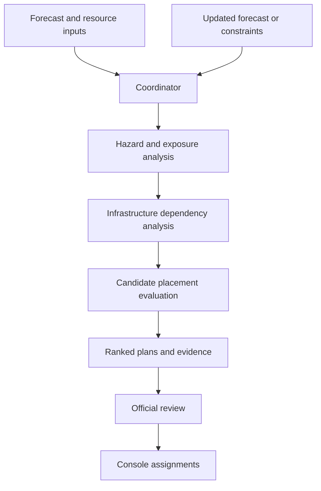

**Give Claude the following implementation brief.** It specifies a **Node.js build for pre-disaster resource planning**, with a Nepal-inspired scenario, clear agent responsibilities, resource links, and a phased build order.

---

# Claude Implementation Brief: CascadeIQ

## 1. Project objective

Build **CascadeIQ**, a multi-agent preparedness dashboard that helps authorities decide where to pre-position limited resources before an expected flood.

The system should answer:

> **“Given the forecast, infrastructure dependencies, and available resources, where should we stage teams and equipment—and what tradeoffs does each plan involve?”**

Build a working Node.js prototype with an interactive map, agent activity, resource-placement recommendations, and an official review workflow.

The default build must run without API keys using clearly labeled synthetic inputs. Real-data integrations should be replaceable adapters.

## 2. Scenario

Use a **Nepal-inspired flood preparedness scenario**.

Include:

- Three settlements.
- One hospital.
- One shelter.
- Two river crossings.
- Several connecting roads.
- Three candidate staging locations.
- Two inspection teams and one rescue team.
- Low, medium, and severe flood scenarios.

All fictional assets, forecast scenarios, resource inventories, and travel times must be labelled as planning estimates in Sources.

Use actual geographic data only after verifying its coverage and suitability. Do not imply that unverified infrastructure represents real Nepal facilities.

### Temporal separation

The planning engine may use only:

- Pre-event imagery and infrastructure.
- Forecasts available before the event, where obtainable.
- Historical vulnerability information.
- Explicitly labeled hypothetical hazard scenarios.

Post-event Maxar imagery and UNOSAT assessments belong in a separate **evaluation view**. They must not influence the pre-event recommendation.

## 3. Main user journey

1. Open the selected area on a map.
2. Select a forecast scenario.
3. Enter the available resource inventory.
4. Click **“Generate preparedness plan.”**
5. Watch agents retrieve inputs and call analytical tools.
6. Inspect exposed roads and potential access disruptions.
7. Compare three candidate resource-placement plans.
8. Change a constraint, such as removing one team or closing a road.
9. Recalculate the recommendations.
10. Approve a plan and create assignments in a console authority inbox.

No actual emergency messages or deployments should occur.

## 4. Recommended stack

| Component | Technology |
|---|---|
| Runtime | Node.js, using a supported LTS version |
| Language | TypeScript |
| Backend | Fastify or Express |
| Frontend | React with Vite |
| Map | MapLibre GL JS; evaluate God’s Eye View as an optional alternative |
| Spatial operations | Turf.js |
| Road analysis | Small graph with Dijkstra’s algorithm |
| Planning | Exhaustive comparison of small candidate-placement combinations |
| Persistence | SQLite |
| Input/output validation | Zod |
| Frontend updates | Server-sent events |
| Tests | Vitest |
| LLM integration | Provider adapter with tool calling; optional for the default build |

**Choose one frontend approach early.** If adapting God’s Eye View takes too long, use MapLibre and preserve the investigation workflow.

The offline build should work without external map tiles, using local GeoJSON layers over a plain background.

## 5. System architecture



Agents should share structured state and evidence IDs. Calculations must come from tools, not language-model estimates.

## 6. Agent responsibilities

| Agent | Responsibility | Required output |
|---|---|---|
| **Hazard Agent** | Load forecast scenarios, footprint, timing, and provenance | Structured hazard scenarios |
| **Infrastructure Agent** | Identify exposed roads, crossings, settlements, and facilities | Exposed asset IDs and dependencies |
| **Access Agent** | Evaluate connectivity and travel times under scenario-specific closures | Access changes and isolated demand nodes |
| **Resource Planning Agent** | Compare feasible resource placements | Ranked plans with metric breakdowns |
| **Coordinator Agent** | Select workflow steps, identify missing inputs, and assemble the brief | Evidence-backed recommendation |
| **Ground Context Agent — stretch** | Organize relevant social reports and camera observations | Timestamped supporting observations |

### Default and optional execution modes

**Default mode:** Deterministic orchestration with clearly labeled rule-based agent modules.

**Optional LLM mode:** The coordinator chooses analytical tools and explains their results. Numerical outputs must remain identical to the tool results.

Do not present scripted activity as autonomous LLM reasoning.

## 7. Data model

Implement these entities:

| Entity | Important fields |
|---|---|
| **Asset** | ID, type, geometry, name, source, timestamp, planning flag |
| **Road edge** | ID, endpoints, travel time, scenario availability, provenance |
| **Hazard scenario** | ID, footprint, time window, affected edges, source, optional probability |
| **Staging site** | ID, network node, eligibility, capacity, resource compatibility |
| **Resource** | ID, type, availability, starting location |
| **Demand location** | ID, required resource type, weight, network node |
| **Evidence** | ID, source URL, observation time, availability time, status |
| **Plan** | Placements, scenario results, objective breakdown, assumptions |
| **Action** | Owner, status, approved plan ID, reviewer, timestamp |
| **Agent event** | Agent, tool, inputs, result summary, evidence IDs |

Keep observation time, publication time, and system retrieval time separate where applicable.

## 8. Analytical tools

Expose these as ordinary TypeScript functions first, then as agent tools:

```text
loadHazardScenarios()
findExposedAssets(scenarioId)
simulateRoadClosures(scenarioId, additionalClosureIds)
calculateAccessChanges(scenarioId)
enumerateFeasiblePlacements(resourceInventory)
evaluatePlacement(plan, scenarios)
rankCandidatePlans(plans)
generatePreparednessBrief(planId)
approvePlan(planId, reviewer)
```

### Exposure analysis

Use hazard geometry and mapped assets to identify intersections.

An intersecting road is **exposed**, not automatically confirmed impassable. Scenario closures must be explicitly supplied or justified by a documented model.

### Resource-placement calculation

For the small build:

1. Enumerate resource placements across candidate sites.
2. Reject placements violating site capacity or resource compatibility.
3. Apply explicit scenario-specific staging eligibility.
4. Calculate travel times from resources to compatible demand locations.
5. Count each demand location once per relevant resource type.
6. Report unreachable locations explicitly.
7. Rank plans using a documented objective.

Use **worst-case coverage across the supplied scenarios** as the default objective, followed by response time as a tie-breaker.

If scenario probabilities are not available, do not invent them. An equal-weight scenario average may be shown as an indicative metric, not a calibrated expected outcome.

Clearly state that the prototype measures modeled accessibility and coverage—not lives saved or operational deployment safety.

## 9. Dashboard

### Map

Display:

- Hazard scenario footprint.
- Roads and crossings.
- Settlements and facilities.
- Candidate staging locations.
- Recommended resource placements.
- Potentially disconnected locations.

### Controls

Allow users to:

- Change scenario.
- Adjust resource counts.
- Disable a candidate staging location.
- Simulate a road becoming unavailable.
- Generate and recalculate plans.
- Reset the scenario.

### Plan comparison

Show the top three plans with:

- Resource placements.
- Coverage by scenario.
- Modeled travel times.
- Unreachable locations.
- Constraints and tradeoffs.
- Evidence and assumptions.

### Agent activity

Show actual workflow events:

> Infrastructure Agent → `findExposedAssets` → two crossings identified.

Avoid invented internal reasoning. Display tool actions and concise findings.

### Review panel

Provide:

- Approve.
- Request revision.
- Reject.
- Create console assignments.

Changes to the forecast or inventory should mark previously approved plans **“Needs review.”**

## 10. Resources and integration links

These are reference and integration candidates; links do not guarantee immediate access or coverage.

### Core implementation

| Resource | Link | Purpose |
|---|---|---|
| Node.js | https://nodejs.org/en/download | Runtime |
| TypeScript | https://www.typescriptlang.org/docs/ | Typed application code |
| Fastify | https://fastify.dev/docs/latest/ | Backend |
| Vite | https://vite.dev/guide/ | Frontend tooling |
| MapLibre GL JS | https://maplibre.org/maplibre-gl-js/docs/ | Interactive map |
| Turf.js | https://turfjs.org/docs/ | Spatial operations |
| Zod | https://zod.dev/ | Schema validation |
| Vitest | https://vitest.dev/guide/ | Tests |
| God’s Eye View | https://github.com/bilawalsidhu/gods-eye-view | Optional visualization foundation |

### Research and imagery

| Resource | Link | Purpose |
|---|---|---|
| Disaster Copilot paper | https://arxiv.org/abs/2510.16034 | Architectural inspiration |
| Maxar AWS registry | https://registry.opendata.aws/maxar-open-data/ | Imagery access and licensing |
| Nepal 2024 imagery browser | https://browser.moregeo.it/external/maxar-opendata.s3.amazonaws.com/events/Nepal-Floods-Sept-2024/collection.json | Inspect scene dates and footprints |
| UNOSAT Kathmandu assessment | https://unosat.org/products/3993 | Post-event evaluation reference |
| Google Earth Engine catalog | https://developers.google.com/earth-engine/datasets | Additional imagery and terrain candidates |
| Google imagery guidelines | https://about.google/brand-resource-center/products-and-services/geo-guidelines/ | Usage and attribution |

### Nepal infrastructure and event context

| Resource | Link | Purpose |
|---|---|---|
| Nepal Department of Hydrology and Meteorology | https://www.dhm.gov.np/ | Investigate historical warnings and observations |
| BIPAD Portal | https://bipadportal.gov.np/ | Investigate disaster and exposure records |
| Humanitarian Data Exchange | https://data.humdata.org/group/npl | Search Nepal geographic datasets |
| Geofabrik Nepal extract | https://download.geofabrik.de/asia/nepal.html | OpenStreetMap road and feature extract |
| OpenStreetMap licensing | https://www.openstreetmap.org/copyright | Attribution and database terms |

Historical forecast access, facility completeness, and road-network quality remain items to verify.

### Optional future integrations

| Resource | Link | Purpose |
|---|---|---|
| NWS API | https://www.weather.gov/documentation/services-web-API | US forecasts and alerts |
| USGS Water Data | https://api.waterdata.usgs.gov/ | US water observations |
| NC FIMAN | https://fiman.nc.gov/ | NC flood context |
| NCDOT services | https://tims.ncdot.gov/tims/V2/webservices | NC incidents |
| DriveNC API | https://www.drivenc.gov/developers/doc | Camera and traffic resources |
| Google Flood Forecasting API access | https://support.google.com/flood-hub/answer/16364306?hl=en | Investigate access; not an MVP dependency |

**US sources are alternatives for a future US scenario, not Nepal data inputs.**

## 11. Suggested repository structure

```text
cascadeiq/
  apps/
    web/
    api/
  packages/
    shared/
    analysis/
    agents/
    adapters/
  data/
    synthetic/
    historical/
  tests/
  docs/
    sources.md
    assumptions.md
    pitch-script.md
  README.md
  .env.example
```

Store credentials only on the server. Keep data provenance and licensing alongside the datasets.

## 12. Build order and completion gates

| Phase | Work | Completion gate |
|---|---|---|
| **1. Synthetic scenario** | Create local assets, roads, hazard scenarios, resources | Data validates and loads |
| **2. Analytical engine** | Exposure, closures, routing, placement comparison | Known scenario produces correct results |
| **3. API** | Scenario, planning, review, and event endpoints | End-to-end API workflow works |
| **4. Dashboard** | Map, controls, plan comparison, evidence | User can change inputs and inspect results |
| **5. Agents** | Structured orchestration and optional LLM adapter | Agents invoke tools and preserve evidence |
| **6. Historical integration** | Add verified Nepal imagery and records | Dates, coverage, and provenance are explicit |
| **7. Polish** | Review workflow, replay, error handling | Complete product works offline |

Do not begin live social scraping, camera-provider integration, or a complex 3D interface before Phase 4 works.

## 13. Required tests

Test the decisions that matter:

- Closing a known bridge disconnects the expected nodes.
- Unreachable locations are not assigned finite travel times.
- Incompatible resources do not satisfy demand.
- Site capacities and resource inventory are respected.
- Disabled staging sites never appear in recommendations.
- Zero available resources produces an explicit unmet-demand result.
- Duplicate coverage is not counted twice.
- Post-event evidence cannot enter a pre-event planning run.
- Input changes invalidate an approved plan.
- Evidence links survive into the final brief.

## 14. Acceptance criteria

The finished demo must:

- Start with documented commands and no required API keys.
- Work with local synthetic data.
- Recalculate placements when constraints change.
- Explain plan rankings using actual analytical results.
- Distinguish simulated scenarios from historical evidence.
- Require review before simulated assignments.
- Show limitations and unresolved inputs.
- Include source links, attribution, assumptions, and a three-minute demo script.

## 15. Three-minute presentation

**0:00–0:30 — Problem**  
“A flood warning tells officials where danger may develop. They still need to decide where to position limited teams.”

**0:30–1:15 — Analysis**  
Select the scenario and inventory. Show exposed crossings and essential-service dependencies.

**1:15–2:15 — Planning**  
Generate three staging plans. Explain their coverage and tradeoffs. Disable a road or remove a team and recalculate.

**2:15–3:00 — Review**  
Inspect evidence, approve a plan, and create simulated assignments. Briefly show the separate post-event evaluation view.

**Implementation instruction to Claude:**  
Build the dependency-free synthetic-data path first. Complete the analytical workflow before optional integrations. Report which inputs are synthetic, which sources were actually connected, what was tested, and what remains incomplete.